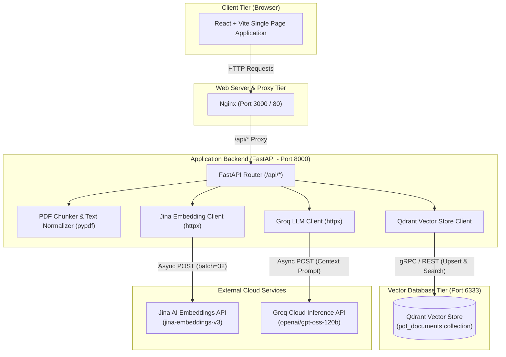
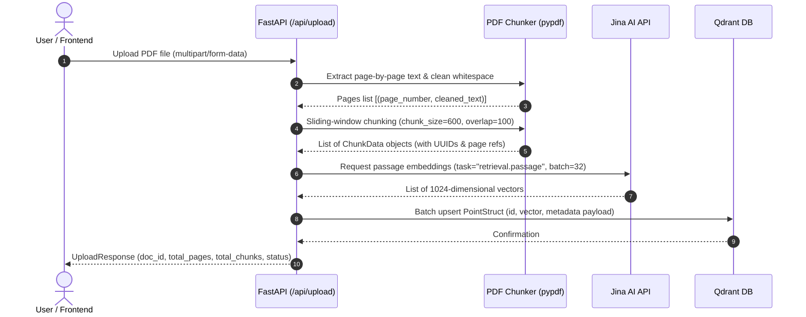
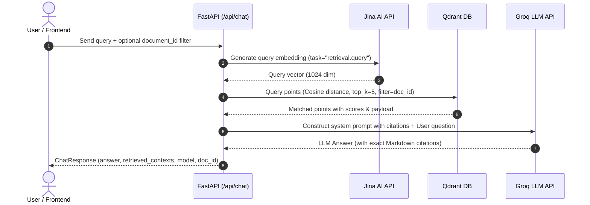

# System Architecture & Technical Design

## 1. Executive Summary

This project is a high-performance, modular **Retrieval-Augmented Generation (RAG)** application designed for querying and analyzing PDF documents with high accuracy, low latency, and verified source citations.

Unlike traditional RAG systems that rely on heavy orchestration frameworks (such as LangChain or LlamaIndex), this system is built with **zero-framework bloat**, utilizing direct asynchronous HTTP clients (`httpx`), native vector operations (`qdrant-client`), and structured Pydantic data pipelines.

### Core Technology Stack
- **Frontend**: React 18, TypeScript, Vite, Tailwind CSS, Lucide Icons, Nginx.
- **Backend**: Python 3.11, FastAPI, Pydantic v2, `httpx` (async), `pypdf`.
- **Embedding Model**: Jina AI `jina-embeddings-v3` (1024-dimensional, task-specific asymmetric embeddings).
- **Vector Database**: Qdrant (Cosine similarity indexing with persistent storage).
- **LLM Inference**: Groq Cloud running `openai/gpt-oss-120b` (ultra-fast inference via custom HTTP client).
- **Deployment & Orchestration**: Multi-container Docker Compose setup.

---

## 2. High-Level System Architecture



---

## 3. End-to-End Data & Execution Pipelines

### 3.1 Ingestion & Vectorization Pipeline (`POST /api/upload`)



1. **Extraction**: The raw PDF binary is read in-memory using `pypdf.PdfReader`. Text is cleaned by normalizing multiple newlines and spaces while maintaining paragraph structure.
2. **Chunking**: A sliding-window algorithm segments the page text into chunks of configured size (`CHUNK_SIZE`, default 600 chars) with overlap (`CHUNK_OVERLAP`, default 100 chars). Chunks respect natural word and newline boundaries.
3. **Embeddings**: Chunks are batched in groups of 32 and sent asynchronously to `https://api.jina.ai/v1/embeddings` specifying `task: "retrieval.passage"`.
4. **Vector Storage**: Each chunk is stored in Qdrant with its 1024-dimensional vector and a JSON payload containing `chunk_id`, `document_id`, `filename`, `text`, `page_number`, `chunk_index`, and `created_at`.

---

### 3.2 Query, Retrieval & Generation Pipeline (`POST /api/chat`)



1. **Asymmetric Embedding**: The user query is vectorized via Jina AI using `task: "retrieval.query"` to align with the passage embeddings in the latent space.
2. **Vector Similarity Search**: Qdrant performs a Cosine similarity search against the indexed collection. If a specific document is selected, a metadata filter `document_id == request.document_id` is applied.
3. **Prompt Synthesis**: Retrieved chunks are sorted and formatted into a structured prompt block detailing `[Source #i] File: <name> | Page: <page> | Relevance: <score>`.
4. **Grounded Generation**: Groq's `openai/gpt-oss-120b` generates an answer strictly constrained to the retrieved context with explicit citations.

---

## 4. Component Deep Dive

### 4.1 Frontend Architecture (`/frontend`)

The frontend is a single-page application (SPA) optimized for speed and clear visual hierarchy.

- **`App.tsx`**: Central state coordinator managing active document selection, document list refresh triggers, context modal display, and tab switching.
- **`Header.tsx`**: Real-time status indicator connecting to `/api/health`, showing connection states for Qdrant, Groq, and Jina AI.
- **`FileUpload.tsx`**: Drag-and-drop dropzone with file size/type validation and dynamic progress states.
- **`DocumentList.tsx`**: Document management panel showing indexed documents, page/chunk statistics, and deletion controls.
- **`ChatInterface.tsx`**: Real-time conversation view with auto-scrolling, quick starter prompts, and document scoping controls.
- **`MessageBubble.tsx`**: Renders assistant responses with Markdown tables, code syntax, and clickable "View Source Context" badges.
- **`ContextModal.tsx`**: Interactive modal allowing users to inspect exact retrieved text chunks, relevance scores, and page citations.
- **`services/api.ts`**: Centralized HTTP client consuming FastAPI REST endpoints with error handling.

---

### 4.2 Backend Architecture (`/backend`)

The backend is built with FastAPI following a service-oriented modular pattern:

| File | Module | Responsibility |
| :--- | :--- | :--- |
| [`main.py`](file:///c:/Users/ayush/Downloads/Code-base-antigravity/backend/app/main.py) | **App Entrypoint** | Initializes FastAPI, sets up CORS middleware, manages startup/shutdown lifespan, registers routes. |
| [`config.py`](file:///c:/Users/ayush/Downloads/Code-base-antigravity/backend/app/config.py) | **Configuration** | Uses Pydantic `BaseSettings` to load and validate environment variables from `.env`. |
| [`models.py`](file:///c:/Users/ayush/Downloads/Code-base-antigravity/backend/app/models.py) | **Domain Schemas** | Pydantic models for request/response validation, chunk representations, and health status. |
| [`chunker.py`](file:///c:/Users/ayush/Downloads/Code-base-antigravity/backend/app/chunker.py) | **Text Extraction & Chunking** | Extracts per-page text via `pypdf`, cleans whitespace, and generates overlapping chunks. |
| [`embedding.py`](file:///c:/Users/ayush/Downloads/Code-base-antigravity/backend/app/embedding.py) | **Jina Client** | Asynchronous HTTP client for batching embeddings against `https://api.jina.ai/v1/embeddings`. |
| [`vector_store.py`](file:///c:/Users/ayush/Downloads/Code-base-antigravity/backend/app/vector_store.py) | **Qdrant Manager** | Manages collection creation (Cosine metric), batch upserting, scroll-based listing, and similarity search. |
| [`llm.py`](file:///c:/Users/ayush/Downloads/Code-base-antigravity/backend/app/llm.py) | **Groq Client** | Direct async HTTP client for Groq Chat Completions, constructing grounded citation prompts. |
| [`routes.py`](file:///c:/Users/ayush/Downloads/Code-base-antigravity/backend/app/routes.py) | **REST Controllers** | Handles `/api/upload`, `/api/chat`, `/api/documents`, `/api/documents/{id}`, and `/api/health`. |

---

### 4.3 Vector Store Schema & Indexing (Qdrant)

- **Collection Name**: `pdf_documents` (configurable via `QDRANT_COLLECTION`).
- **Vector Dimension**: `1024` (matches `jina-embeddings-v3`).
- **Distance Metric**: `Cosine`.
- **Payload Schema**:
  ```json
  {
    "chunk_id": "9b1deb4d-3b7d-4bad-9bdd-2b0d7b3dcb6d",
    "document_id": "f47ac10b-58cc-4372-a567-0e02b2c3d479",
    "filename": "annual_report.pdf",
    "text": "Extracted segment text...",
    "page_number": 3,
    "chunk_index": 12,
    "created_at": "2026-08-23T18:45:00Z"
  }
  ```

---

## 5. API Reference

### `POST /api/upload`
Uploads and indexes a PDF document.
- **Request**: `multipart/form-data` with `file: UploadFile`.
- **Response**: `UploadResponse`
  ```json
  {
    "document_id": "f47ac10b-58cc-4372-a567-0e02b2c3d479",
    "filename": "sample.pdf",
    "total_pages": 12,
    "total_chunks": 48,
    "status": "success",
    "message": "Successfully indexed 'sample.pdf' with 48 chunks."
  }
  ```

### `POST /api/chat`
Sends a query to search vector embeddings and generate a context-grounded response.
- **Request**: `ChatRequest`
  ```json
  {
    "message": "What were the primary revenue drivers in Q3?",
    "document_id": "f47ac10b-58cc-4372-a567-0e02b2c3d479",
    "top_k": 5
  }
  ```
- **Response**: `ChatResponse`
  ```json
  {
    "answer": "According to the report, revenue increased by 22% driven by cloud services [Source #1, Page 4]...",
    "model": "openai/gpt-oss-120b",
    "retrieved_contexts": [
      {
        "chunk_id": "...",
        "document_id": "...",
        "filename": "sample.pdf",
        "text": "...",
        "page_number": 4,
        "score": 0.892
      }
    ],
    "document_id": "f47ac10b-58cc-4372-a567-0e02b2c3d479"
  }
  ```

### `GET /api/documents`
Returns all indexed documents with aggregate metadata.

### `DELETE /api/documents/{document_id}`
Deletes all vector points associated with the specified `document_id`.

### `GET /api/health`
Verifies operational readiness of Qdrant connection and API key configurations.

---

## 6. Deployment & Infrastructure

The application runs in an isolated Docker bridge network (`rag_network`) using three orchestrated services:

```
                  ┌───────────────────────────────┐
                  │      Host System (User)       │
                  └──────────────┬────────────────┘
                                 │
                   Port 3000     │     Port 8000
             ┌───────────────────┼───────────────────┐
             │                   │                   │
             ▼                   ▼                   ▼
    ┌─────────────────┐ ┌─────────────────┐ ┌─────────────────┐
    │  frontend_rag   │ │   backend_rag   │ │   qdrant_rag    │
    │  (Nginx + SPA)  │ │ (FastAPI Server)│ │(Vector Database)│
    │    Port: 80     │ │   Port: 8000    │ │   Port: 6333    │
    └────────┬────────┘ └────────┬────────┘ └────────┬────────┘
             │                   │                   │
             └───────────────────┴───────────────────┘
                       Docker Network: rag_network
                                 │
                                 ▼
                     Persistent Docker Volume:
                          qdrant_storage
```

---

## 7. Key Design Decisions & Benefits

1. **Direct HTTP Clients vs. LangChain**:
   - **Reduced Overhead**: Direct calls via `httpx` avoid abstraction overhead, unexpected internal prompt changes, and large dependency footprints.
   - **Complete Control**: Custom prompt engineering with explicit citation formats and exact payload control.
2. **Asymmetric Embeddings (`jina-embeddings-v3`)**:
   - Distinct embedding tasks (`retrieval.passage` for document indexing vs. `retrieval.query` for search) maximize semantic similarity accuracy.
3. **Word-Boundary Aware Sliding Window Chunking**:
   - Prevents words and sentences from being split in half across chunk boundaries, maintaining coherent semantic meaning for embeddings.
4. **Metadata Preservation**:
   - Every vector point tracks its original document ID, filename, and page number, enabling exact citations and scoped multi-document search.
